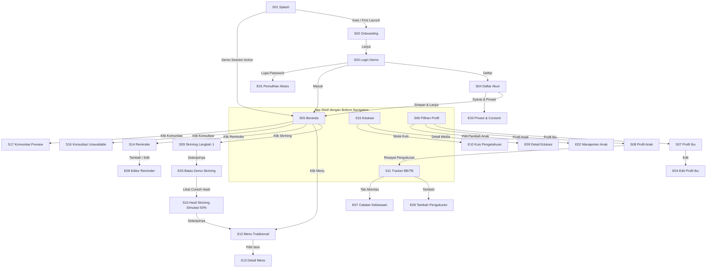

# Design & Implementation Plan: Si Cehat Mobile

**Versi:** 1.0  
**Tanggal:** 26 September 2026  
**Dokumen Referensi:** `DESIGN_SPEC.md` (v1.0), `MEETING_BRIEF.md`, `PRD.md` (v1.0)  
**Target Rilis Awal:** D0 — Demo Lokal Android (APK mandiri, data lokal persisten, 17 layar referensi)

---

## 1. Ringkasan Eksekutif & Prinsip Desain

Rencana implementasi ini menerjemahkan spesifikasi 17 layar referensi (S01–S17) dan 10 layar ekstensi (E01–E10) ke dalam arsitektur aplikasi mobile berbasis **Flutter 3.44+ (Android)**.

### Prinsip Utama:
1. **Kesetiaan Visual (Pixel & Hierarchy Fidelity):** Merekonstruksi layout asli dari PDF 17 layar tanpa menambah dekorasi gamifikasi, maskot petualangan, glassmorphism, atau gradient yang tidak ada di dokumen sumber.
2. **Kejujuran Klinis & Keselamatan Data (Safety-First):**
   - Tidak ada diagnosis atau perhitungan risiko palsu.
   - Default Risk Meter di Beranda (S05): `"Skrining belum tersedia"`.
   - Angka `50%` pada S10 diberi badge permanen: `"SIMULASI · Contoh desain, bukan risiko anak"`.
   - Fitur Konsultasi (S16) dan Komunitas (S17) secara transparan menyatakan status `"Layanan belum aktif pada prototipe ini"`.
3. **Kemandirian Lokal (Offline & Persistensi D0):** Seluruh data profil dummy, pengukuran pertumbuhan, jadwal pengingat, dan riwayat kuis tersimpan secara lokal di perangkat menggunakan penyimpanan lokal (SQLite/SharedPreferences) dan tetap ada setelah aplikasi di-restart.

---

## 2. Arsitektur Teknis & Dependensi

### 2.1 Tech Stack
- **Framework:** Flutter (Channel Stable 3.44.0+), Dart SDK ^3.12.0
- **Target Platform:** Android (minSdkVersion 21, targetSdkVersion 34)
- **State Management:** `provider` (sederhana, scalable, minim boilerplate untuk alur offline-first)
- **Penyimpanan Lokal:**
  - `shared_preferences`: Preferensi aplikasi (onboardingSeen, activeChildId, isDemoMode)
  - `sqflite` + `path`: Database relasional lokal untuk Profil, Pengukuran BB/TB, Reminder, & Riwayat Kuis
- **Tipografi:** `google_fonts` (Poppins) dengan fallback `sans-serif`
- **Ikonografi & Visual:** Material Icons & Cupertino Icons, Custom Canvas untuk Donut Chart & Grafik Tren Pertumbuhan
- **Format Tanggal & Waktu:** `intl` (locale `id_ID`, zona waktu `Asia/Jakarta`)

### 2.2 Dependensi `pubspec.yaml` yang Diperlukan:
```yaml
dependencies:
  flutter:
    sdk: flutter
  cupertino_icons: ^1.0.8
  provider: ^6.1.2
  shared_preferences: ^2.3.2
  sqflite: ^2.3.3+1
  path: ^1.9.0
  google_fonts: ^6.2.1
  intl: ^0.19.0
  fl_chart: ^0.69.0 # Alternatif grafik pertumbuhan BB/TB yang presisi dan responsif
```

---

## 3. Sistem Desain & Visual Tokens

Sesuai `DESIGN_SPEC.md`:

| Token | Nilai Hex / Spesifikasi | Implementasi Flutter |
|---|---|---|
| **Latar Belakang** | `#FFFFFF` (Putih dominan), `#F8F9FA` (Scaffold background) | `ThemeData.scaffoldBackgroundColor` |
| **Field / Card Background** | `#F1F3F4` / `#F5F5F5` (Abu-abu sangat muda) | `Color(0xFFF5F5F5)` |
| **Warna Hijau Utama** | `#4CAF50` (Aksen & Tombol Primer), `#2E7D32` (Kontras teks/WCAG) | `ColorScheme.primary` |
| **Warna Hijau Muda** | `#8BC34A` (Donut secondary) | `Color(0xFF8BC34A)` |
| **Aksen Kuning/Biru** | `#FFC107`, `#2196F3` (Hanya digunakan jika tertera di PDF) | Secondary Accents |
| **Teks Utama** | `#212121` (Hampir hitam, kontras tinggi) | `Color(0xFF212121)` |
| **Teks Sekunder** | `#757575` (Abu-abu netral) | `Color(0xFF757575)` |
| **Border / Divider** | `#E0E0E0` | `Color(0xFFE0E0E0)` |
| **Radius Sudut** | Button (8–12 dp), Card (12 dp), Input (8 dp) | `BorderRadius.circular(12)` |
| **Ukuran Elemen** | Tombol (min 52 dp), Input field (min 56 dp), Tap Target min 48 dp | `BoxConstraints(minHeight: 48)` |
| **Spacing Grid** | 8 dp, 12 dp, 16 dp, 24 dp, 32 dp (Horizontal gutter: 24 dp) | `EdgeInsets.symmetric(horizontal: 24)` |

---

## 4. Struktur Database Lokal & Model Data

### 4.1 Schema Database SQLite (`si_cehat_local.db`)

1. **`mother_profile`**
   - `id` (INTEGER PRIMARY KEY)
   - `name` (TEXT) - default: `"Ibu Rina"`
   - `education` (TEXT) - e.g., `"S1 / Diploma"`
   - `occupation` (TEXT) - e.g., `"Ibu Rumah Tangga"`
   - `address` (TEXT) - e.g., `"Bandung, Jawa Barat"`

2. **`child_profile`**
   - `id` (INTEGER PRIMARY KEY AUTOINCREMENT)
   - `name` (TEXT) - default: `"Ahmad"`
   - `date_of_birth` (TEXT) - format `YYYY-MM-DD` (date-only)
   - `gender` (TEXT) - `"Laki-laki"` / `"Perempuan"`
   - `health_notes` (TEXT) - catatan kesehatan singkat
   - `is_active` (INTEGER) - 1 jika profil sedang aktif

3. **`growth_measurements`**
   - `id` (INTEGER PRIMARY KEY AUTOINCREMENT)
   - `child_id` (INTEGER, FK)
   - `date` (TEXT) - `YYYY-MM-DD`
   - `weight` (REAL) - berat dalam kg (contoh: 20.5)
   - `height` (REAL) - tinggi dalam cm (contoh: 118.0)
   - `source` (TEXT) - e.g., `"Posyandu"`, `"Mandiri"`
   - `notes` (TEXT)

4. **`reminders`**
   - `id` (INTEGER PRIMARY KEY AUTOINCREMENT)
   - `title` (TEXT) - e.g., `"Sarapan Pagi"`, `"Minum air putih"`
   - `time` (TEXT) - format `HH:mm` (contoh: `"07:00"`)
   - `is_enabled` (INTEGER) - 1 (aktif) atau 0 (nonaktif)
   - `repeat_days` (TEXT) - e.g., `"Setiap Hari"`

5. **`recipes` (Static Bundled Seed)**
   - `id` (TEXT PRIMARY KEY)
   - `category` (TEXT) - `"makanan"`, `"minuman"`, `"cemilan"`
   - `name` (TEXT) - e.g., `"Sayur Asem"`, `"Pepes Ikan"`, `"Nasi Tutuk Oncom"`
   - `summary` (TEXT) - e.g., `"Tinggi serat, rendah gula"`
   - `calories` (TEXT) - `"120 kkal/porsi"`
   - `fiber` (TEXT) - `"4.5 g"`
   - `protein` (TEXT) - `"3.2 g"`
   - `ingredients` (TEXT JSON)
   - `instructions` (TEXT JSON)

6. **`education_contents` & `quiz_attempts`**
   - Menyimpan daftar materi video/podcast/kuis dan riwayat jawaban per `child_id`.

---

## 5. Pemetaan 17 Layar & Navigasi



### Aturan Bottom Navigation Bar:
Hanya ditampilkan pada layar yang sesuai spesifikasi PDF:
- **Tampil:** `S05 Beranda`, `S06 Pilihan Profil`, `S07 Profil Ibu`, `S08 Profil Anak`, `S12 Menu Tradisional`, `S15 Edukasi`.
- **Tidak Tampil (Menggunakan Android Back/Chevron):** `S01`, `S02`, `S03`, `S04`, `S09`, `S10`, `S11`, `S13`, `S14`, `S16`, `S17`, serta seluruh layar ekstensi E01–E10.

---

## 6. Rencana Kerja Bertahap (Sprint T00 – T07)

Berdasarkan kesepakatan pada `MEETING_BRIEF.md`, implementasi dipecah menjadi modul berurutan:

### 🟢 Fase 1: Fondasi Proyek & Sistem Desain (Task T00)
- **T00.1:** Konfigurasi `pubspec.yaml` (dependencies, font Poppins, assets structure).
- **T00.2:** Pembuatan Design System (`AppColors`, `AppTypography`, `AppTheme`, `AppSpacing`).
- **T00.3:** Komponen Reusable Dasar:
  - `PrimaryButton` (Tinggi 52 dp, warna hijau `#4CAF50`, disabled/loading states).
  - `AppTextField` (Tinggi 56 dp, background `#F5F5F5`, rounded border 8 dp).
  - `SafetyBanner` & `SimulationBadge` (Badge peringatan oranye/abu-abu `"DEMO · Data contoh"`).
  - `CustomAppBar` (Putih, elevation 0, leading chevron back).
- **T00.4:** Setup database lokal SQLite (`DatabaseHelper`) & inisialisasi data seed.

---

### 🟢 Fase 2: Onboarding & Autentikasi Demo (Task T01)
- **T01.1 — S01 Splash Screen:**
  - Teks terpusat `"Si Cehat"` (hijau tebal) + `"Sistem Cerdas Anak Sehat / Anti Diabetes"` (hitam tebal).
  - Inisialisasi DB di latar belakang, navigasi otomatis ke S02 atau S05.
- **T01.2 — S02 Onboarding Screen:**
  - Headline besar 3 baris: `"Jaga Anak, / Cegah Diabetes / Sejak Dini"`.
  - Catatan keselamatan pendek: *"Pendamping edukasi dan kebiasaan sehat keluarga. Bukan alat diagnosis."*
  - Tombol aksesibel `"Lanjut"` menuju S03.
- **T01.3 — S03 Login Demo Screen:**
  - Headline `"Selamat Datang / Kembali!"`.
  - Field Email/No. HP dan Password masked.
  - Banner `"Mode demo · tidak terhubung ke akun nyata"`.
  - Tombol `"Masuk"` (langsung membuka sesi lokal).
  - Tautan `"Lupa Password?"` (membuka E01) dan `"Daftar"` (membuka S04).
- **T01.4 — S04 Daftar Akun Screen:**
  - Field: Nama Ibu, No. HP, Email, Password.
  - Validasi form lokal tanpa logging password.

---

### 🟢 Fase 3: App Shell, Navigasi Bawah, & Beranda (Task T02)
- **T02.1 — Shell Navigasi:**
  - `MainShellScreen` mengelola 4 tab (Beranda, Tracker, Edukasi, Profil).
  - Active color `#4CAF50`, inactive color `#757575`.
- **T02.2 — S05 Beranda Screen:**
  - Header sapaan: `"Halo, Ibu Rina!"` dan `"Selamat Pagi"`.
  - Card atas: **Diabetes Risk Meter** dengan teks default aman:
    - Status: `"Skrining belum tersedia"` (bukan risiko rendah otomatis).
    - Subteks: *"Lakukan skrining untuk memahami faktor risiko kebiasaan anak."*
  - Panel **Menu Utama** (Grid 3 + 2):
    1. Skrining (ikon clipboard) $\rightarrow$ S09
    2. Menu (ikon mangkuk makanan) $\rightarrow$ S12
    3. Reminder (ikon lonceng) $\rightarrow$ S14
    4. Konsultasi (ikon bubble chat) $\rightarrow$ S16
    5. Komunitas (ikon group/orang) $\rightarrow$ S17

---

### 🟢 Fase 4: Pengelolaan Profil Ibu & Anak (Task T03)
- **T03.1 — S06 Pilihan Profil:**
  - Ilustrasi siluet ibu menggendong anak di atas.
  - Dua kartu opsi: `"Profil Ibu"` $\rightarrow$ S07, `"Profil Anak"` $\rightarrow$ S08.
  - Bagian bawah: Tombol `"Keluar Sesi Demo"` & `"Reset Data Demo"`.
- **T03.2 — S07 Profil Ibu:**
  - Avatar lingkaran generik.
  - 4 Baris: Nama Ibu, Pendidikan, Pekerjaan, Alamat.
  - Tombol edit (E04) untuk memperbarui nilai secara lokal.
- **T03.3 — S08 Profil Anak:**
  - Avatar anak generik.
  - 4 Baris: Nama Anak, Tanggal Lahir, Riwayat Kesehatan, Riwayat Pengukuran.
  - Tap Riwayat Pengukuran langsung mengarahkan ke S11 Tracker.

---

### 🟢 Fase 5: Skrining Simulasi Berlabel (Task T04)
- **T04.1 — S09 Skrining Langkah 1 dari 3:**
  - App bar dengan tombol kembali.
  - Indikator `"Langkah 1 dari 3"`.
  - Input: Usia Anak (tahun), Berat Badan (kg), Tinggi Badan (cm).
  - Validasi angka biologis wajar.
- **T04.2 — E05 Gate/Modal Transparansi Skrining:**
  - Pesan jelas: *"Instrumen skrining belum ditetapkan. Data ini tidak menghasilkan penilaian risiko klinis."*
  - Dua aksi: `"Kembali"` atau `"Lihat Contoh Hasil (Simulasi)"`.
- **T04.3 — S10 Hasil Skrining Simulasi:**
  - Badge tebal: `"SIMULASI · 50% hanya contoh desain, bukan risiko anak"`.
  - Donut chart 50% (setengah hijau tua, setengah hijau muda).
  - Teks: *"Anda memiliki risiko sedang terhadap diabetes melitus"*.
  - 3 Rekomendasi pola hidup sehat dengan ikon panah.
  - Tombol `"Selanjutnya"` mengarahkan ke S12 (Katalog Menu).

---

### 🟢 Fase 6: Tracker Pertumbuhan & Riwayat Pengukuran (Task T05)
- **T05.1 — S11 Tracker Screen:**
  - Tab `Tumbuh Kembang` (aktif) dan `Aktivitas`.
  - Kartu Grafik BB (Kg) berbasis riwayat pengukuran anak dari SQLite.
  - Kartu Ringkasan: **Berat Badan Terakhir** (`20,5 kg`) dan **Tinggi Badan Terakhir** (`118 cm`).
  - Tombol hijau `"Tambah Pengukuran"` membuka form E06.
- **T05.2 — E06 Form Tambah Pengukuran:**
  - Input: Tanggal, Berat Badan (kg), Tinggi Badan (cm), Catatan.
  - Simpan langsung mengupdate grafik S11 secara reaktif.
- **T05.3 — E07 Tab Aktivitas (Proposed FGD):**
  - List catatan aktivitas fisik, konsumsi air, dan jam tidur sederhana.

---

### 🟢 Fase 7: Menu Tradisional & Edukasi Kesehatan (Task T06)
- **T06.1 — S12 Menu Tradisional Sehat:**
  - 4 Filter Chips: `Semua`, `Makanan`, `Minuman`, `Cemilan`.
  - Daftar Card Makanan: Gambar thumbnail, Judul (e.g. *Sayur Asem*, *Pepes Ikan*, *Nasi Tutuk Oncom*), Subtitle khasiat gizi.
- **T06.2 — S13 Detail Menu:**
  - Hero image makanan.
  - 3 Ringkasan nutrisi: Energi (kkal), Serat (g), Protein (g).
  - Bahan-bahan, Porsi, dan Cara Memasak.
- **T06.3 — S15 Edukasi Sehat:**
  - 3 Tab: `Video`, `Podcast`, `Quiz`.
  - List card video/podcast dengan durasi dan thumbnail.
- **T06.4 — E10 Kuis Pengetahuan Interaktif:**
  - Pertanyaan pilihan ganda seputar kebiasaan makan sehat anak.
  - Feedback skor berlabel `"Jawaban Benar"`, bukan penentu risiko diabetes.

---

### 🟢 Fase 8: Reminder & Layanan Terbatas (Task T07)
- **T07.1 — S14 Reminder Screen:**
  - Header `+ Tambah Reminder` (membuka E08).
  - 4 Kartu contoh: Sarapan Pagi (07:00), Minum Air (10:00), Aktivitas Fisik (16:00), Waktu Tidur (20:00).
  - Switch aktif/nonaktif yang tersimpan di database lokal.
  - Keterangan status: *"Jadwal tersimpan di perangkat"*.
- **T07.2 — S16 Konsultasi (Unavailable State):**
  - 3 Card: Bidan, Ahli Gizi, Dokter.
  - Tap memunculkan dialog/bottom sheet transparan: *"Layanan konsultasi belum aktif pada prototipe ini. Untuk konsultasi darurat, hubungi fasilitas kesehatan terdekat."*
- **T07.3 — S17 Komunitas (Preview State):**
  - Tab: `Semua`, `Populer`, `Saya`.
  - Feed placeholder contoh dengan label preview.
  - Tombol `+ Buat Postingan` memunculkan info bahwa fitur ini membutuhkan moderasi dan akun pilot.

---

## 7. Rencana Eksekusi File & Struktur Folder `lib/`

```
lib/
├── main.dart                      # Entry point, theme provider, DB init
├── core/
│   ├── constants/
│   │   ├── colors.dart            # Palet hijau #4CAF50, abu-abu, teks
│   │   └── typography.dart        # Poppins TextTheme & weights
│   ├── database/
│   │   ├── database_helper.dart   # SQLite open & schema migrations
│   │   └── seed_data.dart         # Seed menu, edukasi, default ibu & anak
│   └── widgets/
│       ├── primary_button.dart    # Tombol 52 dp standar
│       ├── app_text_field.dart    # Input form 56 dp
│       ├── safety_banner.dart     # Badge simulasi & demo
│       └── custom_app_bar.dart    # White app bar dengan chevron back
├── data/
│   ├── models/
│   │   ├── child_model.dart
│   │   ├── mother_model.dart
│   │   ├── measurement_model.dart
│   │   ├── reminder_model.dart
│   │   ├── recipe_model.dart
│   │   └── quiz_model.dart
│   └── repositories/
│       ├── profile_repository.dart
│       ├── tracker_repository.dart
│       ├── reminder_repository.dart
│       └── recipe_repository.dart
├── providers/
│   ├── auth_provider.dart         # Status demo login & onboarding
│   ├── profile_provider.dart      # Aktif child, edit profil
│   ├── tracker_provider.dart      # Grafik & entri pengukuran baru
│   └── reminder_provider.dart     # Switch toggle & list reminder
└── screens/
    ├── splash/
    │   └── splash_screen.dart     # S01
    ├── onboarding/
    │   └── onboarding_screen.dart # S02
    ├── auth/
    │   ├── login_screen.dart      # S03
    │   ├── register_screen.dart   # S04
    │   └── forgot_password_sheet.dart # E01
    ├── shell/
    │   └── main_shell_screen.dart # Shell dengan BottomNav S05, S11, S15, S06
    ├── home/
    │   └── home_screen.dart       # S05 Beranda
    ├── profile/
    │   ├── profile_select_screen.dart # S06
    │   ├── mother_profile_screen.dart # S07
    │   ├── child_profile_screen.dart  # S08
    │   ├── edit_profile_screen.dart   # E04
    │   └── child_manage_sheet.dart    # E02
    ├── screening/
    │   ├── screening_step1_screen.dart # S09
    │   ├── screening_demo_dialog.dart  # E05
    │   └── screening_result_screen.dart # S10
    ├── tracker/
    │   ├── tracker_screen.dart    # S11
    │   ├── add_measurement_sheet.dart # E06
    │   └── habit_log_screen.dart  # E07
    ├── menu/
    │   ├── menu_catalog_screen.dart # S12
    │   └── menu_detail_screen.dart  # S13
    ├── reminder/
    │   ├── reminder_screen.dart   # S14
    │   └── reminder_editor_sheet.dart # E08
    ├── education/
    │   ├── education_screen.dart  # S15
    │   ├── education_detail_screen.dart # E09
    │   └── quiz_screen.dart       # E10
    ├── consultation/
    │   └── consultation_screen.dart # S16
    └── community/
        └── community_screen.dart  # S17
```

---

## 8. Matriks Pengujian & Verifikasi (Acceptance Criteria)

| ID Tes | Fokus Pengujian | Verifikasi yang Diharapkan |
|---|---|---|
| **AC-01** | Visual Layout | 17 layar identik secara struktur, tata letak kartu, dan warna dengan PDF referensi. |
| **AC-02** | Bottom Navigation | Bottom bar hanya muncul di S05, S06, S07, S08, S12, S15; tidak bocor ke S11/S13/S14/detail. |
| **AC-03** | Safety & Disclaimer | Beranda default *"Skrining belum tersedia"*; Donut S10 memuat badge permanen *"SIMULASI"*; Konsultasi & Komunitas transparan *"Belum aktif"*. |
| **AC-04** | Persistensi Data | Tambah pengukuran di S11, ubah nama di S07, atau toggle switch di S14 $\rightarrow$ Tutup app $\rightarrow$ Buka lagi $\rightarrow$ Data tidak hilang. |
| **AC-05** | Responsivitas & Form | Diuji pada lebar 360, 390, dan 412 dp; keyboard muncul tidak menyebabkan overflow (menggunakan `SingleChildScrollView` & padding). |
| **AC-06** | Reset Demo | Opsi di S06 dapat mengembalikan data ke seed awal dengan konfirmasi dialog. |

---

## 9. Rekomendasi Urutan Eksekusi

1. **Step 1:** Inisialisasi dependensi di `pubspec.yaml` dan pembuatan token tema/desain (`core/constants`).
2. **Step 2:** Pembuatan lapisan data lokal (`DatabaseHelper` SQLite & repositori).
3. **Step 3:** Implementasi Layar Pembuka & Auth (S01, S02, S03, S04).
4. **Step 4:** Implementasi Shell & Beranda (S05).
5. **Step 5:** Implementasi Modul Profil (S06, S07, S08) & Tracker Pertumbuhan (S11).
6. **Step 6:** Implementasi Skrining Simulasi Berlabel (S09, S10).
7. **Step 7:** Implementasi Menu Tradisional (S12, S13), Reminder (S14), Edukasi (S15), serta Konsultasi & Komunitas (S16, S17).
8. **Step 8:** Pengujian lokal, validasi restart aplikasi, dan verifikasi tampilan.
